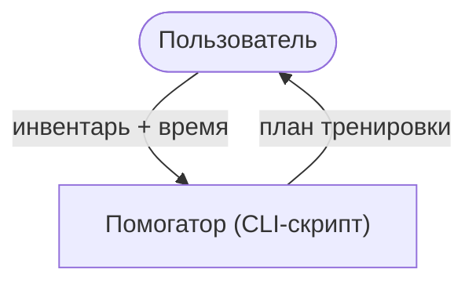
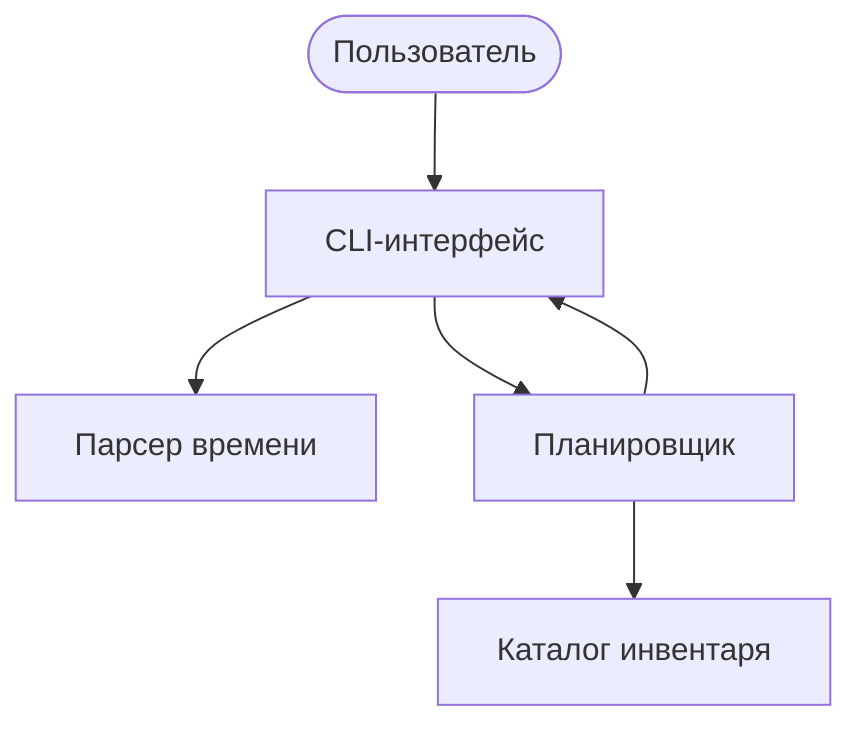

# Архитектура проекта «Помогатор» (C4, уровни C1–C2)

## C1 — System Context (контекст системы)

Пользователь работает со скриптом через терминал: передаёт список инвентаря
и доступное время тренировки, получает готовый план подходов.
Внешних систем нет: всё выполняется локально, без сети и БД.

## C2 — Container diagram (контейнеры)

| Контейнер | Ответственность | Реализация |
|---|---|---|
| CLI-интерфейс | ввод/вывод, диалог с пользователем | Python, `input/print` |
| Парсер времени | приводит «43 мин», «1 ч», «3.2 часа» к минутам | Python, `re` |
| Планировщик | рандомизированная раскладка подходов в рамках лимита времени | Python, `random` |
| Каталог инвентаря | мин/макс длительность блока по каждому снаряду | dict / JSON |

## Ключевые архитектурные ограничения планировщика

- блок одного снаряда не короче 5–6 мин (исключает «чередование по 1 минуте»);
- не более 2 блоков одного снаряда за тренировку;
- между блоками отдых 2 мин, входит в общий лимит;
- суммарное время блоков + отдых не превышает время пользователя.
